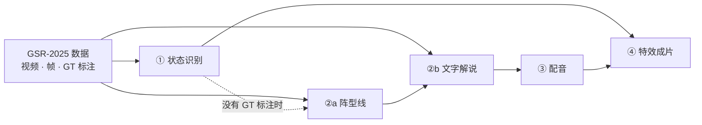

# SoccerMaster: A Vision Foundation Model for Soccer Understanding
Official implementation of **SoccerMaster: A Vision Foundation Model for Soccer Understanding** (CVPR 2026 Oral)

[*Haolin Yang*](https://haolinyang-hlyang.github.io/),
[*Jiayuan Rao*](https://jyrao.github.io/),
[*Haoning Wu*](https://haoningwu3639.github.io/),
[*Weidi Xie*](https://weidixie.github.io/)


<div style="line-height: 1;">
  <a href="https://haolinyang-hlyang.github.io/SoccerMaster/" target="_blank" style="margin: 2px;">
    
  </a>
  <a href="https://arxiv.org/pdf/2512.11016" target="_blank" style="margin: 2px;">
    
  </a>
</div>

> **这是 SoccerMaster 的 fork。** `codes/` 和下方折叠的上游说明来自论文作者，引用与权重见
> [上游仓库](https://github.com/haolinyang-hlyang/SoccerMaster)。`pipeline/` 与 `multi-agent/`
> 是本 fork 在上游识别结果之上新增的战术层，不属于论文，也未经同行评审。

## 仓库里有什么

| 部分 | 解决什么问题 | 位置 |
|---|---|---|
| **pipeline** | 把一段 30 秒比赛视频做成带中文战术解说、配音和战术图形的成片 | `pipeline/`，入口在 `scripts/` |
| **multi-agent** | 实验：让模型「先描述画面、规则打分、再裁决」，能否比直接问模型更准地识别战术 | `multi-agent/` |

两部分运行上互不依赖，只共用 `pipeline/video_models.py` 调用 Doubao / Gemini。
其余目录：`codes/` 是上游代码，`benchmark/` 放 ②b 的人工输入，`data/` 下的两个 csv 是
multi-agent 的标注，`tests/` 是离线测试。

## 环境准备

**Python。** 按下方折叠说明建好上游的 tracklab 环境（Stage ① 需要 GPU），所有命令都在这个环境里跑。
另外补装：

```bash
pip install openai httpx pytest
```

系统里要有 `ffmpeg` / `ffprobe`。Stage ③ 还要把 [CosyVoice](https://github.com/FunAudioLLM/CosyVoice)
克隆到 `codes/CosyVoice/` 并按其说明装依赖，权重放在模型根目录的 `Fun-CosyVoice3-0.5B/`。

**模型根目录**写死为 `/data/zhangzheng/pretrained_models`，换机器要改三处：
`pipeline/stage3_tts/cosyvoice.py`，以及 `codes/sn-gamestate/sn_gamestate/sn_gamestate/configs/`
下的 `gsr_step_1_example.yaml`、`gsr_step_3_example_accelerate.yaml`。

**API Key**（只有 ②b 和 multi-agent 调模型）。代码只读环境变量，不会自动加载 `.env`：

```bash
cp .env.example .env            # 填 ARK_API_KEY（Doubao）或 GEMINI_API_KEY（Gemini）
set -a && source .env && set +a
```

凡是会把视频上传给外部 API 的命令，都必须显式加 `--allow-external-upload`。

**数据**不在仓库里，放在 `data/GSR-2025/`（SoccerNet GSR v1.3 格式）：
`videos/SNGS-xxx.mp4`、`images/SNGS-xxx/img1/*.jpg`、`images/SNGS-xxx/Labels-GameState.json`、
`sequences_info.json`。

<details>
<summary><b>上游环境、模型与数据格式</b>（Stage ① 的前置条件，上游原文）</summary>

### 1. Environment Setup

Create a conda environment and install dependencies:

```bash
conda create -n tracklab_release python=3.10.16
conda activate tracklab_release

pip install torch==2.4.1 torchvision==0.19.1 torchaudio==2.4.1 --index-url https://download.pytorch.org/whl/cu121

pip install setuptools==78.1.1
cd ./codes/sn-gamestate
pip install -e .
cd ../tracklab
pip install -e .
cd ../sam2
pip install -e .

pip install albumentations==1.4.19
pip install git+https://github.com/huggingface/transformers
pip install accelerate==1.8.1
pip install "qwen-vl-utils[decord]==0.0.8"
pip install flash-attn --no-build-isolation
```

### 2. Download Pretrained Models

First, download the SigLIP2 backbone model to the pretrained models directory:

```bash
pip install huggingface_hub
hf download google/siglip2-large-patch16-512 --local-dir /data/zhangzheng/pretrained_models/google/siglip2-large-patch16-512
```

### 3. Download SoccerMaster Checkpoints

Clone the SoccerMaster model checkpoints from Hugging Face:

```bash
cd /data/zhangzheng/pretrained_models
mkdir SoccerMaster
hf download xleprime/SoccerMaster --local-dir SoccerMaster
```

After completing these steps, the SigLIP2 and SoccerMaster checkpoints live under `/data/zhangzheng/pretrained_models/`:

```
/data/zhangzheng/pretrained_models/
├── google/
│   └── siglip2-large-patch16-512/
└── SoccerMaster/
```

### 4. Prepare Pretrained Models

Please organize `/data/zhangzheng/pretrained_models/` as follows:

```
/data/zhangzheng/pretrained_models/
├── calibration
│   ├── mean.npy
│   ├── pnl_SV_kp
│   ├── pnl_SV_lines
│   ├── Radar.png
│   ├── std.npy
│   ├── SV_kp
│   └── SV_lines
├── google
│   └── siglip2-large-patch16-512
├── jn
│   ├── Qwen2.5-VL-72B-Instruct
│   └── Qwen2.5-VL-7B-Instruct
├── legibility
│   └── legibility_resnet34_soccer_20240215.pth
├── reid
│   ├── hrnetv2_w32_imagenet_pretrained.pth
│   └── prtreid-soccernet-baseline.pth.tar
├── SoccerMaster
│   └── ...
└── yolo
    └── yolo_v8x6_finetuned.pt
```

**Download instructions:**

- **calibration & reid**: Follow the instructions from [SoccerNet Game State Recognition](https://github.com/soccernet/sn-gamestate) to obtain the calibration and ReID pretrained models.
- **google**: Download `siglip2-large-patch16-512` from [Hugging Face](https://huggingface.co/google/siglip2-large-patch16-512).
- **legibility**: Download `legibility_resnet34_soccer_20240215.pth` from [Google Drive](https://drive.google.com/file/d/18HAuZbge3z8TSfRiX_FzsnKgiBs-RRNw/view?usp=sharing), following the [jersey-number-pipeline](https://github.com/mkoshkina/jersey-number-pipeline) project.
- **jn**: Download Qwen2.5-VL models from the [Qwen2.5-VL Collection](https://huggingface.co/collections/Qwen/qwen25-vl) on Hugging Face.
- **yolo**: Move `yolo_v8x6_finetuned.pt` to `/data/zhangzheng/pretrained_models/yolo/`. This file can be obtained from [https://huggingface.co/xleprime/SoccerMaster](https://huggingface.co/xleprime/SoccerMaster).

### Input Data Format

The data pipeline follows the [SoccerNet Game State Recognition (GSR)](https://github.com/soccernet/sn-gamestate) format. You need to organize your input video frames into the following directory structure. The audited layout uses `SNGS-001` through `SNGS-200`; one sequence is shown below:

```
data/GSR-2025/
├── sequences_info.json
├── videos/
│   ├── SNGS-001.mp4
│   └── ...
└── images/
    ├── SNGS-001/
    │   └── img1/
    │       ├── 000001.jpg
    │       ├── 000002.jpg
    │       ├── ...
    │       └── 000750.jpg
    └── ...
```

Each video sequence should be extracted into individual frames (`.jpg`), placed under `<sequence_name>/img1/`, and named with zero-padded 6-digit indices starting from `000001.jpg`.

You also need to prepare a `sequences_info.json` file that registers all sequences. The format is as follows:

```json
{
    "version": "1.3",
    "train": [
        {
            "id": 1,
            "name": "SNGS-001",
            "n_frames": 750
        }
    ],
    "validation": [],
    "test": [],
    "challenge": []
}
```

Each entry contains:
- `id`: a unique integer index for the sequence.
- `name`: the directory name of the sequence (must match the folder name under `images/`).
- `n_frames`: the total number of frames in the sequence.

</details>

## 一、pipeline：从比赛视频到带解说和特效的成片



下文 `$OUT` 指每个 clip 的工作目录 `outputs/preprocessing/<clip>/`，所有阶段共用。

| 阶段 | 做什么 | 为什么需要 | 产物 |
|---|---|---|---|
| ① 状态识别 | 检测跟踪球员和球，SAM2 精修，再做场地标定、球衣号、队伍识别 | 得到每一帧「谁在球场哪个位置」，是 ④ 画图的坐标来源 | `$OUT/predictions.json`<br/>`$OUT/homography_per_frame.json` |
| ②a 阵型线 | 每秒找出可见球员稳定排成的锋线、中场线、后防线；看不清的只记录、不下结论 | 给解说提供客观的几何证据，不让模型凭空说「打穿了防线」 | `outputs/tactical_topology/<clip>.json` |
| ②b 文字解说 | 先让模型看视频、围绕人工锁定的战术整理证据链；再只凭这条证据链写 2–3 句解说 | 拆成两步，保证解说的每句话都能追溯到画面 | `outputs/tactical_commentary/<provider>/<clip>.json` |
| ③ 配音 | 本地 CosyVoice 合成中文语音，从战术发生的时刻起贴回视频 | 把文字变成能直接播的解说 | `$OUT/voice/commentary_zh.mp3`<br/>`$OUT/voice/final_video.mp4` |
| ④ 特效 | 给球员画光圈、给持球人打光柱、叠上阵型线（内部重算，不依赖 ②a 的输出），再混入 ③ 的配音 | 让观众看见解说里说的战术结构 | `$OUT/annotated_video.mp4`，并覆盖 `final_video.mp4` |

### 跑通一个 clip

```bash
CLIP=SNGS-148
OUT=outputs/preprocessing/$CLIP     # ②a/②b 固定从这里读，不要改
DATA=data/GSR-2025
mkdir -p $OUT

# ① 状态识别（GPU，最耗时；只要文字和配音可以跳过）
bash scripts/run_stage1.sh $DATA/images/$CLIP $OUT

# ②a 阵型线（不调模型）
python scripts/run_tactical_topology.py analyze --clip-uid $CLIP

# ②b 文字解说
cp $DATA/videos/$CLIP.mp4 $OUT/clip.mp4     # 没有阶段会生成它，②b 和 ③ 都要读
python scripts/run_tactical_commentary.py run --provider doubao \
    --clip-uid soccernetgs:$CLIP --allow-external-upload

# ③ 配音
STAGE3_COMMENTARY_RECORD=outputs/tactical_commentary/doubao/$CLIP.json \
    bash scripts/run_stage3.sh $OUT

# ④ 特效成片 → $OUT/voice/final_video.mp4
bash scripts/run_stage4.sh $OUT --clip-dir $DATA/images/$CLIP
```

**能解说哪些 clip：** ②b 只处理在 `benchmark/tactical_prototypes/recognition_review.jsonl` 里
有一条人工锁定战术（`verdict: correct`）的 clip，目前是 27 个 GSR-2025 clip。其余参数见各脚本 `--help`。

<details>
<summary>上游手动运行 GSR 三步（<code>run_stage1.sh</code> 已封装，单独调试 Stage ① 时才需要）</summary>

The data pipeline consists of three steps.

### Step 1: Detection & Tracking

```bash
cd codes/sn-gamestate
CUDA_VISIBLE_DEVICES=0 python -m tracklab.main -cn gsr_step_1_example
```

### Step 2: SAM2 Segmentation Refinement

Use SAM2 to refine the tracking results with precise segmentation masks, then merge the refined results back into the tracker state.

```bash
cd codes/sam2/step_2

# Run SAM2 segmentation inference (supports multi-GPU)
bash gsr_step2_example.sh

# Merge segmentation results back into the tracker state
bash merge_example.sh
```

### Step 3: Remaining Modules

Run the remaining pipeline modules: camera calibration, jersey number recognition, role classification, team assignment, etc.

```bash
cd codes/sn-gamestate
CUDA_VISIBLE_DEVICES=0 python -m tracklab.main -cn gsr_step_3_example_accelerate
```

> **Model selection for Step 3:**
>
> For best results, use `Qwen2.5-VL-72B-Instruct` for jersey number (jn) recognition and `Qwen2.5-VL-7B-Instruct` for role classification (config: `gsr_step_3_example`). However, for faster inference speed and lower GPU memory consumption, you can use the accelerated config (`gsr_step_3_example_accelerate`) which merges both tasks into a single module and uses `Qwen2.5-VL-7B-Instruct` for both, with a minor trade-off in accuracy (Recommended).

</details>

## 二、multi-agent：战术识别对照实验

直接问视频大模型「这是什么战术」，它容易凭整体印象猜。这里把判断拆开，看能不能更准。
两条臂在同一批 37 个人工标注 clip 上、用同一套指标对比：

| 臂 | 流程 | 文件 |
|---|---|---|
| **A+B+rule→C** | A 只描述空间（球推进到哪个区域、防线是否站好…），B 只列动作时间线（传球、抢断…），两者都不许说战术名；8 条写死的规则据此给 8 种战术打分；C 再看视频，从得分前三里裁决 | `multi-agent/pilot.py` |
| **C-only**（对照组） | 一次调用，模型直接看视频八选一 | `multi-agent/c_only.py` |

两条臂都支持 `--provider doubao` / `--provider gemini`。

```bash
# 先用 1 个 clip 冒烟，确认 key 和视频都没问题
python multi-agent/pilot.py run --provider doubao --run-id smoke --clip-id SNGS-010 --allow-external-upload

# 全量 37 个 clip，跑完出报告；中途失败的 clip 加 --retry-failed 补跑
python multi-agent/pilot.py  run    --provider doubao --run-id r5 --allow-external-upload
python multi-agent/pilot.py  report --run-id r5
python multi-agent/c_only.py run    --provider gemini --run-id g1 --allow-external-upload
python multi-agent/c_only.py report --run-id g1
```

结果在 `multi-agent/outputs/multiagent_pilot/<run-id>/`（C-only 在 `.../c_only/<run-id>/`）：

| 文件 | 看什么 |
|---|---|
| `metrics.json` | `accuracy`、`macro_f1`。先和 `majority_baseline`（永远猜最常见的战术）比，高出才有意义 |
| `review.md` | 逐 clip 的判断依据和最终答案，人工复查读这个 |
| `clips/<clip>.json` | 单 clip 完整记录；`final.source` 标明答案来自 C 还是规则 |

输入：视频 `data/GSR-2025/videos/`，标注 `data/grounded_tactics/gsr2025_gt_37.csv`，
战术定义 `data/足球战术数据库_词条表_Grid.csv`。

## 常见报错

| 报错 | 原因与处理 |
|---|---|
| `ARK_API_KEY is not set` / `no Gemini API key is set` | `.env` 不会自动加载，先 `set -a && source .env && set +a` |
| `ARK_RESPONSES_MODEL must be ...` | 把 `.env` 里这一项留空 |
| 找不到 `clip.mp4` | 没有阶段会生成它：`cp data/GSR-2025/videos/<clip>.mp4 $OUT/clip.mp4` |
| `must have exactly one correct locked fact` | 这个 clip 没有人工锁定的战术，②b 不能处理 |
| `TTS exceeds its ...s slot even after speed-up` | 配音从战术时刻播到片尾，最多加速 1.5 倍仍放不下：解说太长，或战术发生得太晚 |
| 改了代码重跑，结果没变 | ②a、②b、④ 发现产物已存在会直接跳过，加 `--force` |
| `manifest does not match ... use a new run-id` | multi-agent 改了 prompt、规则或数据后，要换一个新 `--run-id` |

## 测试

离线运行，不调用任何 API：

```bash
python -m pytest tests -q            # pipeline
python multi-agent/test_pilot.py     # multi-agent：规则、两条臂的流程与指标
```
